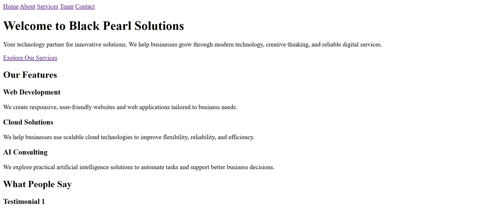
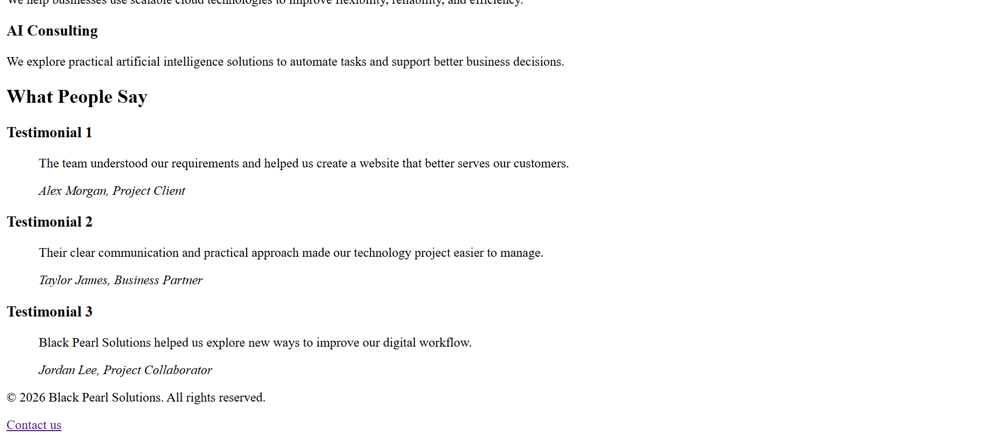

# Black Pearl Solutions

## Introduction

Black Pearl Solutions is a five-page website built using HTML. It introduces the company, its services, team, and contact information. The website includes a navigation menu to move between pages, a service comparison table, team profiles, and a contact form.

## Website Pages

- **Home:** Introduces the company, highlights its services, and displays customer testimonials.
- **About:** Contains the company history, mission, and core values.
- **Services:** Describes the services offered and includes a comparison table.
- **Team:** Displays twelve team members grouped into two departments.
- **Contact:** Includes a contact form, company contact details, and an embedded Google Map.

## Technologies Used

- HTML5
- Semantic HTML elements
- Accessible form labels and table markup
- Open Graph metadata
- Git and GitHub
- GitHub Pages

## Installation

### Setup Steps

1. Clone the repository:

   git clone https://github.com/Erin-Eldho/five-page-website.git

2. Navigate to the project folder:

   cd five-page-website

3. Open the project folder in Visual Studio Code.

4. Open index.html in your browser, or use the Live Server extension to run the website locally.

## Folder Structure

- index.html – Home page
- about.html – About page
- services.html – Services page
- team.html – Team page
- contact.html – Contact page
- images/ – Contains website images and the homepage screenshot
- media/ – Contains media files
- README.md – Project documentation

## Homepage Screenshot

## Live Website

[Visit Black Pearl Solutions](https://erin-eldho.github.io/five-page-website/)

## Deployment Status

The website has been deployed using GitHub Pages.
